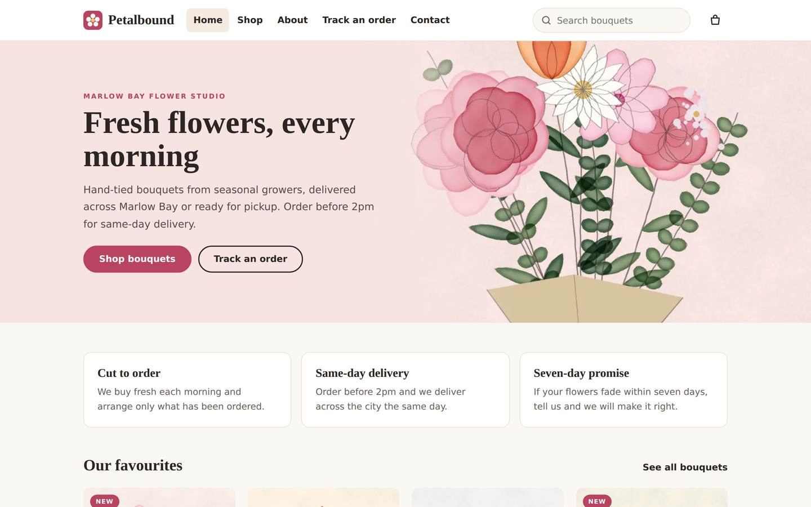
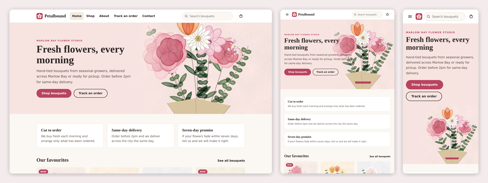

# Petalbound — SkyNet Flower Shop Template

A responsive flower shop with online ordering, card payment and a staff area, for **ASP.NET Core (.NET 10)**, built on the **SkyNet Framework**.

[](https://dotnet.microsoft.com/)
[](https://www.nuget.org/packages/TheSkyLite.SkyNet)



> **Sample content.** Petalbound, its 14 bouquets, prices, delivery zones and people are placeholders; replace them in the staff area (**Pages**, **Bouquets**, **Settings**) or in `data/site.json`. Orders, messages, staff and the activity log are saved for real in `data/*.json`.

## Features

- **20 pages:** Home, Shop, Product, Cart, Pay, Track, About, Contact (public); Sign in, Dashboard, Orders, Shipping, Bouquets, Pages, Media library, Messages, Settings, Users, Activity log, My account (staff)
- **Responsive:** desktop, tablet and phone layouts
- **Online ordering:** shop by occasion, price and search; sizes and extras; a cart kept in the browser; delivery or pickup with a date and time slot
- **The server checks everything:** it re-prices every cart, checks stock, the delivery zone (by postcode prefix), the date, the slot and the same-day cut-off. Stock is held when an order is placed and released on cancel. Unpaid card orders expire after 45 minutes.
- **Payment:** Stripe Checkout (no card fields on this site) or pay on delivery/pickup. The server confirms the payment with Stripe when the customer returns; there is no webhook. Refunds are sent from the order screen.
- **Order tracking** by order number plus email
- **Staff area** with one side menu: orders, shipping board by day and courier, bouquets and occasions, page editor, media library, messages from the contact form, settings, users and an activity log
- **Media library** (its own page in the staff menu): upload photos (JPG, PNG, WebP, GIF up to 8 MB) and MP4 videos (30 MB by default; change it in **Settings**, up to 100 MB). Files are checked by their contents, saved to `images/uploads/` and listed in `data/media.json`. A file still used on the site cannot be deleted.
- **Pages editor:** Home, Shop, About, Track and Contact are each a list of blocks edited in place (click any text to change it, drag or use the arrows to move, hide, remove). Twelve block types: page top, text, picture and text, cards, steps, numbers, checklists, people, questions, quote, picture or video, call to action. Blocks marked *From your data* (favourite bouquets, occasions, delivery, bouquet list, track form, contact form) stay on their page. The last five saves of every page are kept and can be restored.
- **Photos per bouquet:** up to 6 photos from the library, in the order you choose. The first is the main photo; the product page shows the others as a gallery.
- **Staff accounts:** per-area View / Edit / Extra rights, 8-hour sessions, sign-in throttling, forced password change, every change and refused request logged
- **No front-end build:** plain HTML, CSS and vanilla JavaScript



## Getting started

Requirements: .NET 10 SDK.

    cd FlowerShop
    dotnet run

The SkyNet package (`TheSkyLite.SkyNet`) restores from NuGet. The app opens on **Home** at http://localhost:5231.

### Taking card payments

1. In **Settings**, enter the **site address** (for example `https://flowers.example.com`). Stripe needs it for the return link.
2. Paste your Stripe **secret key** (`sk_test_...` to try, `sk_live_...` to go live). It is saved in `data/payment.json` and never shown again.
3. Until both are set, customers only see "Pay on delivery or pickup".

> Stripe was **not** exercised during the build (no network access and no keys on the test machine). Try it with a `sk_test_` key and Stripe's test card before going live.

## Permissions

| Area | Rights | Extra right |
|---|---|---|
| Orders | View, Edit | Extra: cancel and refund |
| Shipping | View, Edit | Extra: dispatch and deliver |
| Bouquets | View, Edit | Extra: publish and delete |
| Pages | View, Edit | |
| Media library | View, Edit | Extra: delete files |
| Messages | View, Edit | |
| Activity log | View only | |
| Users, Settings | managers only | |

Staff with only the Orders View right see the orders but no change buttons; a request sent anyway is refused and logged.

## Run mode

`appConfig/application.cfg` has `app.app.runmode`:

- **0 Demo** (as shipped): the staff sign-in is filled in (`demo` / `demo1234`) and any user name and password signs in as a demo manager with every right.
- **1 Production:** staff sign in with their own accounts. Set this before you go live.

## First sign-in (Production)

1. Run the site on your computer and open **/AdminLogin**. The page shows the first user name (`admin`) and a password made just for this site. It is shown only on the computer the site runs on, and is also in `appConfig/initial-admin.txt`.
2. Sign in and choose your own password. The box and the file disappear.
3. Open **Users** and add an account for each person.

Forgot the first password before using it? Delete `appConfig/initial-admin.txt` and open the sign-in page again. Locked out of every manager account? Remove the managers from `data/staff.json` and open the sign-in page.

## Deploying

1. Publish with the `web.config` from the project (IIS). Create `images/uploads/` on the server, then give the application pool Modify on `data/`, `temp/`, `appConfig/` and `images/uploads/`. Use HTTPS.
2. If nobody has signed in yet, read the first password from `appConfig/initial-admin.txt` on the server.
3. Check that `/data/staff.json`, `/data/payment.json` and `/appConfig/initial-admin.txt` answer 404 in a browser.

> **Redeploying:** publishing copies `data/` over the live files (orders and the media list included). Download the live `data/` and `images/uploads/` folders first or leave them out of the publish.

## Project structure

    appConfig/   application.cfg, initial-admin.txt (first start only)
    codes/       page classes; Core/ (Store, Access, Auth, Blocks, Media, Pricing, Orders, Payments, Ui); Models/
    htmls/       markup with {plhd_*} placeholders
    scripts/     one IIFE per page
    styles/      one stylesheet per page, every class prefixed
    data/        site.json (content), then media, orders, messages, staff, activity, payment as they are created
    images/      bouquets/ occasions/ about/ hero.webp, and uploads/ for files added in the media library

### One page = four files, one name

| File | Holds |
|---|---|
| `codes/[Page].cs` | the page class and its server methods |
| `htmls/[Page].html` | markup with `{plhd_*}` placeholders |
| `scripts/[Page].js` | one IIFE namespace, `[Page]Js` |
| `styles/[Page].css` | styles, every class prefixed (`sh-` for Shop, `ao-` for Orders, ...) |

## SkyNet in action

    $ApiRequest('Shop/List', JSON.stringify([{ key: 'occ', vlu: 'birthday' }]));

```csharp
public async Task<ApiResponse> List()
{
    ApiResponse response = new ApiResponse();
    // ...filter the published bouquets...
    response.SetElementContents("sh-grid", Grid(list));
    return response;
}
```

| Page | Request | Response |
|---|---|---|
| Shop | `List` | redraws the cards and the count |
| Product | `Quote` | new price for the chosen size, extras and quantity |
| Cart | `Price`, `Place` | totals and fee; places the order and goes to Pay |
| Pay | `Start`, `Check` | opens Stripe Checkout; re-checks the payment |
| Track | `Find` | shows the order status |
| AdminOrders | `Act` | start, pay, cancel, refund, note |

## Customize it

- **Page text and pictures:** **Pages** in the staff area; shop name, phone, address and hours are in **Settings**; occasions are a tab on **Bouquets**
- **Delivery zones, slots, tax, cut-off:** **Settings** in the staff area
- **Brand name, colors, fonts:** the custom properties at the top of each `styles/*.css`
- **New pictures and videos:** **Media library** in the staff area, then choose them on a bouquet or a home page block

## License

- **This template** (all source files, artwork and data in this repository): [MIT License](LICENSE) — free to use, modify and redistribute, including commercially.
- **SkyNet Framework** (`TheSkyLite.SkyNet` NuGet package): proprietary, free to use for eligible users including commercial use; see the license included in the package.
